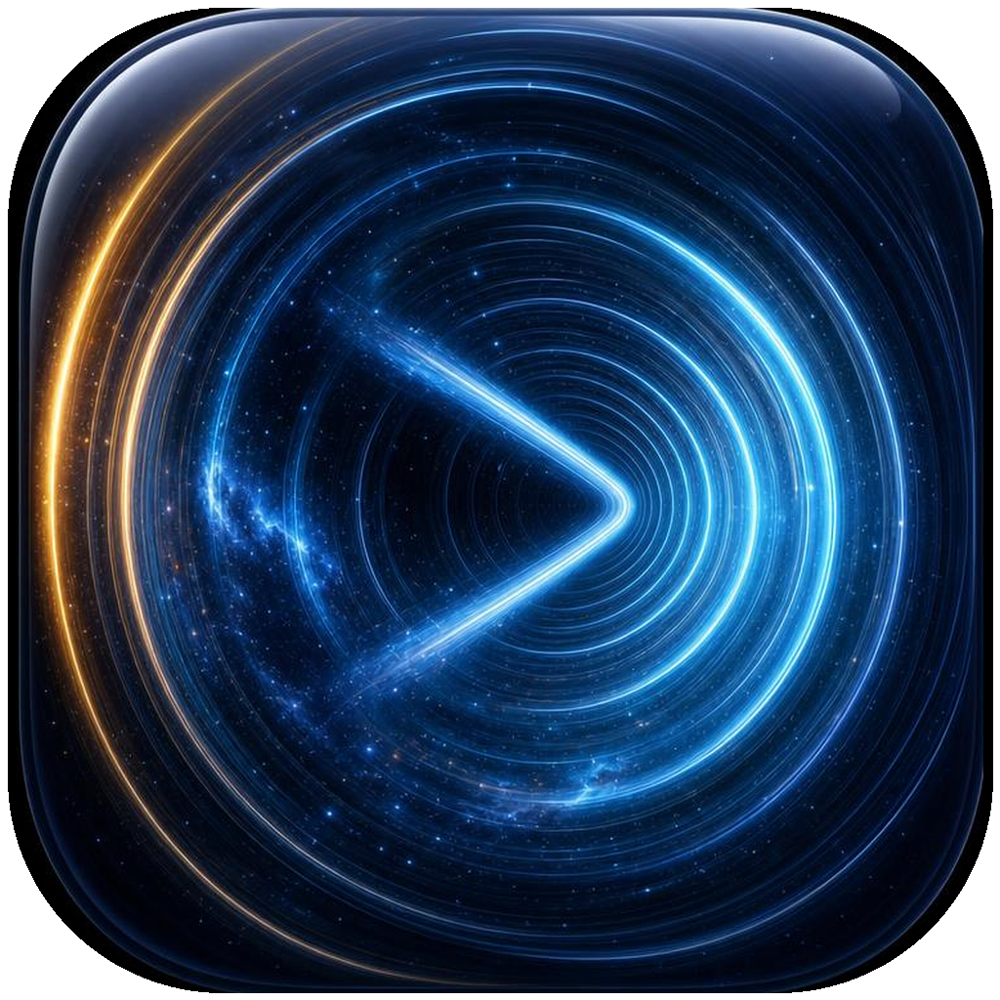

# cgcode

[简体中文](README.md) | [繁體中文](README.zh-TW.md) | [English](README.en.md) | [日本語](README.ja.md) | **한국어**

## 장점

- **모델 자유**: 기본은 SenseNova(日日新)이며 DeepSeek, 통의천문, Kimi 및 OpenAI 호환 API·중계 서비스를 모두 쓸 수 있습니다. 터미널판은 Chat API 어댑터를 내장해 Chat API만 지원하는 모델로도 에이전트를 완전히 구동합니다. 데스크톱판은 화면에서 언제든 모델을 바꿀 수 있습니다.
- **완전한 중국어**: 화면, 명령 설명, 환영 페이지, 안내, 기본 탑재 스킬이 모두 중국어 간체입니다.
- **쉬운 시작**: 첫 실행 시 중국어 설정 마법사가 연결을 자동 테스트합니다. 데스크톱판은 API 키 하나만 입력하면 되고 해외 계정이 필요 없습니다.
- **개인정보 우선**: 키는 내 PC에만 저장되고 대화는 내가 설정한 모델로만 전송됩니다. 사용 데이터 전송과 텔레메트리는 기본적으로 꺼져 있고, 자동 업데이트는 cgcode 자체 주소에만 연결합니다.
- **안정성**: 속도 제한 시 자동 재시도, 예비 엔드포인트 자동 전환을 지원합니다.
- **풍부한 스킬**: 터미널판 6개, 데스크톱판 38개 기본 탑재. 중국어 스킬 마켓에서 검색하고 보안 점검 후 원클릭 설치할 수 있으며, 탈옥 스킬은 포함하지 않습니다.
- **올인원**(데스크톱판): 채팅, 웹 검색, Word/Excel/PPT, 이미지, 코딩, 멀티 에이전트 협업, 예약 작업, 컴퓨터 제어, 웹 읽기, 장기 기억, 로컬 오프라인 모델, 음성, 크리에이터 스튜디오.
- **보안**: 모든 창을 샌드박스로 격리했고, 클라이언트와 함께 배포되는 취약한 의존성은 수정 버전으로 올렸습니다. 인터넷에서 구성 요소를 설치하는 스킬은 버전을 고정하고 설치 전에 반드시 동의를 받습니다.
- **디자인**: iOS 스타일 UI(iOS 블루, 큰 모서리 둥글기), 터미널판 테마 7종, 음악이 있는 10초 시작 애니메이션.

## 단점

- Windows 전용입니다.
- 실제 Windows PC에서의 검수가 아직 끝나지 않았습니다.
- 설치 파일이 서명되지 않아 첫 실행 시 Windows 경고가 나타나며 "실행"을 눌러야 합니다.
- 데스크톱판 설치 파일은 약 340MB이며, 현재는 GitHub에 로그인해 Actions 페이지에서 내려받아야 합니다.
- 자동 업데이트는 저장소에서 GitHub Pages를 켜고 업데이트 파일을 게시한 뒤에야 작동합니다.
- 일부 기능은 처음 사용할 때 추가 구성 요소(Node.js, uv, Ollama 등)를 설치해야 하며, 음성 기능은 Python과 성능 좋은 NVIDIA GPU가 필요합니다.
- 로그인이 필요한 소셜 플랫폼 읽기는 기본적으로 꺼져 있으며, 켜면 계정 정지 위험이 있습니다.
- 반투명 유리 등 완전한 iOS 효과와 휴대폰 원격 제어는 아직 제공하지 않습니다.
- SenseNova 등 모델 서비스는 속도 제한이 있어 혼잡 시간에는 자동 재시도를 기다려야 합니다.
